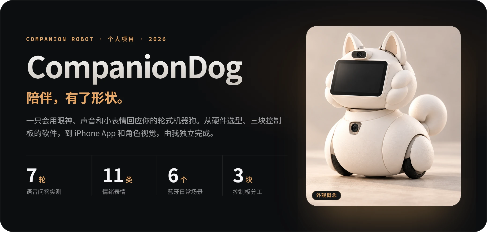
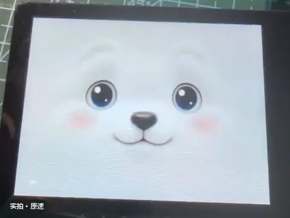
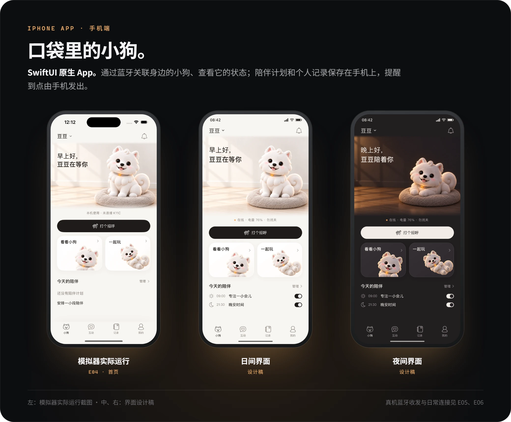

  

  <a href="docs/evidence.md"><b>Footage &amp; acceptance records</b></a>　·　<a href="docs/technology.md"><b>How it works</b></a>　·　<a href="https://companiondog-project-portfolio.syrupy-lyric-7681.chatgpt.site/"><b>Interactive portfolio ↗</b></a>　·　<a href="README.md"><b>中文</b></a>
    
  <code>RK3566</code> <code>ESP32-S3 ×2</code> <code>Face detection &amp; recognition</code> <code>On-device wake word &amp; dictation</code> <code>Cloud dialogue</code> <code>SwiftUI + Bluetooth</code> <code>WebRTC</code>
    
  Figures and the linked detail pages are in Chinese; every figure has a full English description in its alt text.

## What it looks like now

  
   Expression screen on its own board · real footage at real speed · a touch makes it smile, and wakes it from sleep　<a href="docs/evidence.md#看实拍表情屏怎样回应触摸">Watch the three full clips →</a>

## Progress at a glance

✅ Verified on hardware　🧪 Bench test or standalone prototype　🚧 Not yet verified　·　Every row maps to a numbered entry in the [acceptance records](docs/evidence.md).

| | Capability | How far it has been verified | Record |
| :---: | --- | --- | :---: |
| ✅ | Expressions &amp; touch | 11 emotion animations; touch triggers, directed gaze, back to idle when an animation ends | [E01](docs/evidence.md#e01) |
| ✅ | Gaze following | Two-board test: sustained gaze left, centre and right; sleeps when the person leaves, wakes when they return | [E10](docs/evidence.md#e10) |
| ✅ | Recognising its owner | Single-owner enrolment, recognition, deletion and re-enrolment; a consenting stranger came back as “unknown” | [E08](docs/evidence.md#e08) |
| ✅ | Voice Q&amp;A | 7 complete question-and-answer rounds; recording, waiting for the answer, synthesis and playback can each be cancelled | [E03](docs/evidence.md#e03) |
| ✅ | Wake word &amp; interruption | Saying “小狗” (“puppy”) wakes it; follow-ups work for a short while without the wake word; touching the screen stops it talking | [E09](docs/evidence.md#e09) |
| ✅ | Remembering preferences | With permission, a preference note is written and later brought up correctly in a related conversation | [E07](docs/evidence.md#e07) |
| ✅ | iPhone connection | Real-iPhone Bluetooth read, write and reconnection; 6 everyday scenarios such as auto-connect, restore after relaunch and manual pause | [E05](docs/evidence.md#e05) [E06](docs/evidence.md#e06) |
| 🧪 | Wheel speed control | Two temporary wheels ran off the ground and stopped; driving on the floor, load and braking distance not yet tested | [E02](docs/evidence.md#e02) |
| 🧪 | Remote video | An iPad browser showed live video over Wi-Fi and a phone hotspot and reconnected after a refresh; not yet in the app | [E11](docs/evidence.md#e11) |
| 🚧 | Whole robot | Assembly and power, head tilt, ear and tail motion, turning on the floor, obstacle and edge avoidance, long runs | — |

## How it responds to you

When it is connected to the main board, a touch is also sent back to that board, so touching the screen while the dog is talking makes it stop ([E09](docs/evidence.md#e09)).

Tested on both boards together: sustained gaze to the left, centre and right; it sleeps when the person leaves and wakes when they come back ([E10](docs/evidence.md#e10)). The eye movement is a screen animation, so no mechanical head is needed.

![Owner-recognition diagram: enrol once, and it knows you from then on. On the left, a dot-pattern face marks face detection and facial landmarks. On the right, three steps: enrolment extracts facial features; the feature template is stored encrypted on the device and can be deleted or re-enrolled; later faces are compared against the template. “Owner” leads to personalised interaction; “unknown” is not treated as the owner. Smiles and an open mouth are only interaction cues and are not used to judge mood. Used only for companionship, not for security authentication, no liveness check; tested in E08](media/owner-id.webp)

Following a face doesn’t require knowing who it is. Recognising the owner requires enrolling first, and it is used only for companionship, never for security authentication ([E08](docs/evidence.md#e08)).

It completed 7 full question-and-answer rounds on the device, with cancellation tested during recording, waiting for the answer, synthesis and playback ([E03](docs/evidence.md#e03)). The wake word, quick follow-ups and touch-to-stop are covered in [E09](docs/evidence.md#e09).

![Memory diagram: talk again a few days later and it still remembers what you like. Short-term memory: you say “I like jazz”, then ask “what instruments does this kind of music use?”, and it knows “this kind of music” means jazz. Long-term memory in four steps: ask for consent; turn the conversation into a preference note in the cloud, which needs a network connection; store it encrypted on the device, separately for each owner; when relevant, use only content it is allowed to use. Days later, when music comes up, it mentions that you like jazz. The example sentences are made up; tested in E07](media/memory.webp)

The tester confirmed that the preference note was right and that it came up naturally in a later related conversation ([E07](docs/evidence.md#e07)). Returning accurately to each topic after switching between several topics is still being verified.

## How the robot is built

![Bench diagram: wheels and remote video, each verified on its own first. Left, the wheel speed loop: the motion board (ESP32-S3, PI control) drives two N20 encoder motors through a DRV8833 and the encoders report actual speed; tested with two temporary wheels running off the ground and stopping; driving on the floor, load and braking distance untested (E02). Right, the remote video prototype: a USB camera captures video, the RK3566 main board encodes it to H.264 in hardware, and WebRTC carries it to an iPad browser; works over Wi-Fi and a phone hotspot, reconnects after a refresh, not yet in the app (E11)](media/bench.webp)

Part numbers and roles are listed in the [technical notes](docs/technology.md); full-size photos are in the [acceptance records](docs/evidence.md#看样件实际使用或采购了哪些器件).

## What I did

This is a solo project; the main acceptance tests ran from August to October 2026.

- **Hardware architecture and selection:** split the work across three control boards (an RK3566 main board and two ESP32-S3s) and chose the camera, motor driver and encoder motors, as well as the ear and tail servos and the sensors.
- **On-device vision and speech:** face detection, owner recognition and smile detection; a local wake word and Chinese dictation; gaze-direction and touch-event messages between the main board and the expression board.
- **Conversation and memory:** connected cloud answers and streaming speech synthesis, cancellable at all four stages and stoppable with a touch; long-term memory kept separately for each owner and encrypted.
- **Motion control:** the motion board reads encoder feedback and uses PI control to keep both wheels at their target speed.
- **iPhone app:** device pairing, status, automatic reconnection and reminders, built with SwiftUI and CoreBluetooth.
- **Character and visuals:** the Samoyed character and its expressions, the app’s day and night interfaces, and the hand-drawn courtyard scene.
- **Verification and records:** for every capability, what was tested and what was not, written up as records E01–E11 in this repository.

## Design trade-offs

- **Eyes instead of a turning head.** The eyes on the screen can follow people before any mechanical head exists. The head is planned to tilt in one direction only; turning left and right is left to the differential-drive base, which turns the whole body.
- **Listen locally, think in the cloud.** The wake word and dictation run offline on the device; answers and speech synthesis come from the cloud. The cost is that it needs a network connection, and recovery after the network drops has not been tested yet.
- **Interruptible at any time.** Every stage from recording to playback can be cancelled; a touch on the screen stops it mid-sentence, without waiting for it to finish.
- **Memory only with consent.** Preferences are saved only after memory is switched on and you agree to the note being written; records are kept separately for each owner and encrypted on the device. Face matching is used only for companionship, not for security authentication.
- **Every claim states its limits.** Each conclusion says what it covers. For example, the wheels have only turned on a bench off the ground, so that is no evidence the whole robot can drive.

## App and visual prototypes

Real-iPhone Bluetooth read, write and reconnection, plus 6 everyday scenarios such as auto-connect, restore after relaunch and manual pause, have been verified ([E05](docs/evidence.md#e05) [E06](docs/evidence.md#e06)).

[View the full hand-drawn courtyard scene](media/courtyard.png). The latest courtyard and animations still need native integration and overall acceptance; the vegetable-garden game is still being explored.

## Next steps

- **Whole robot:** the ear and tail servos, distance sensor and edge sensors have been chosen; the head actuator and final power supply are still open. Next comes verifying assembly and power, head and ear/tail motion, turning on the floor, obstacle and edge avoidance, robot–app integration and long runs.
- **App:** bring the latest courtyard and animations into the native app, and bring remote video into the app.

---

Showcase compiled on 2026-11-12 from project materials verified up to 2026-10-23. This repository contains public descriptions, form studies and selected showcase material only: no firmware source, internal wiring, private samples or deployment configuration.
