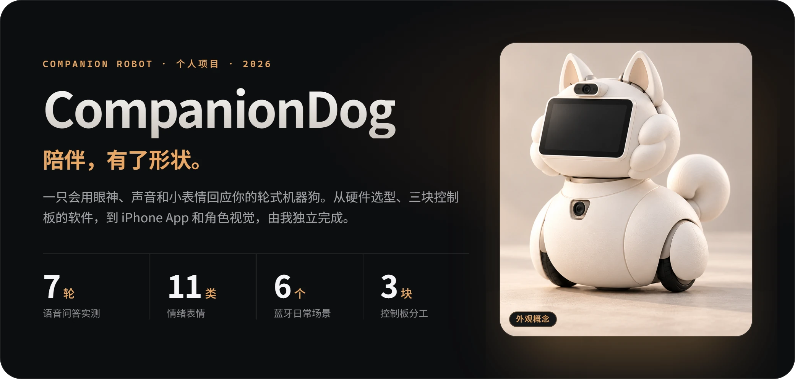
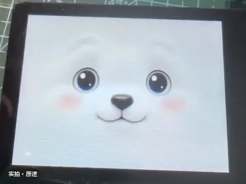
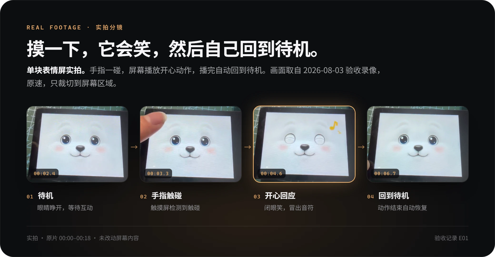
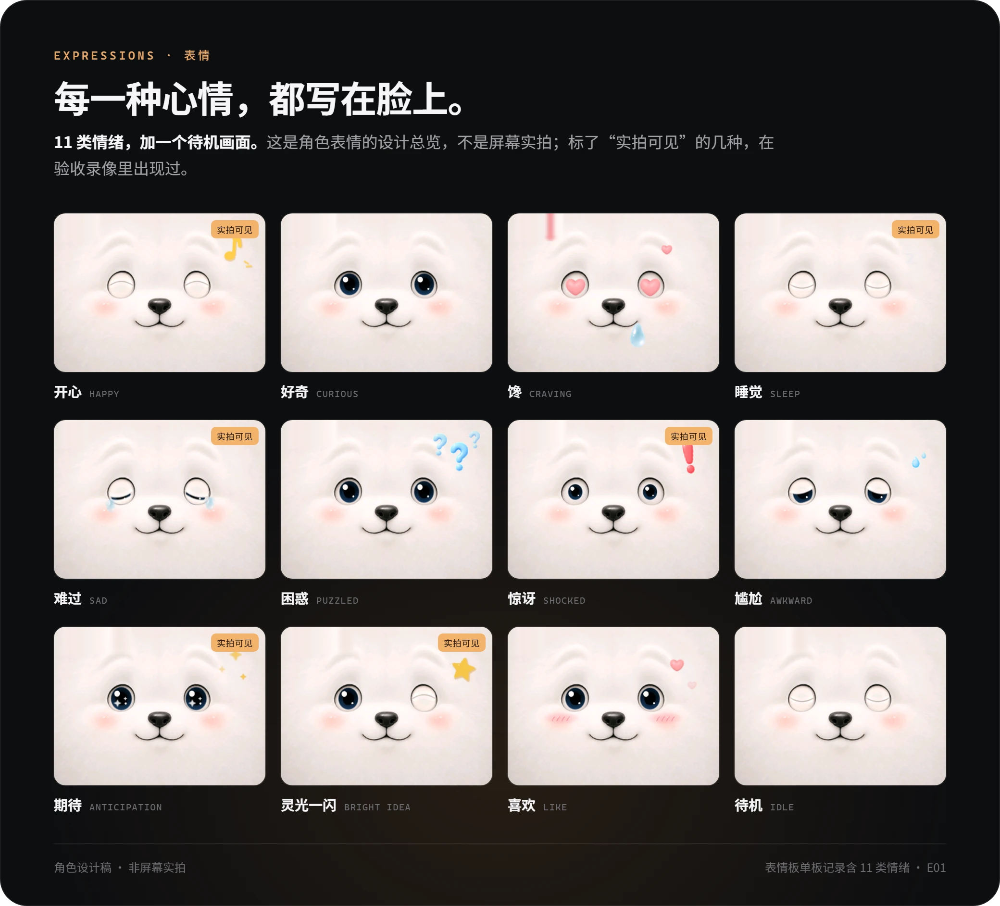
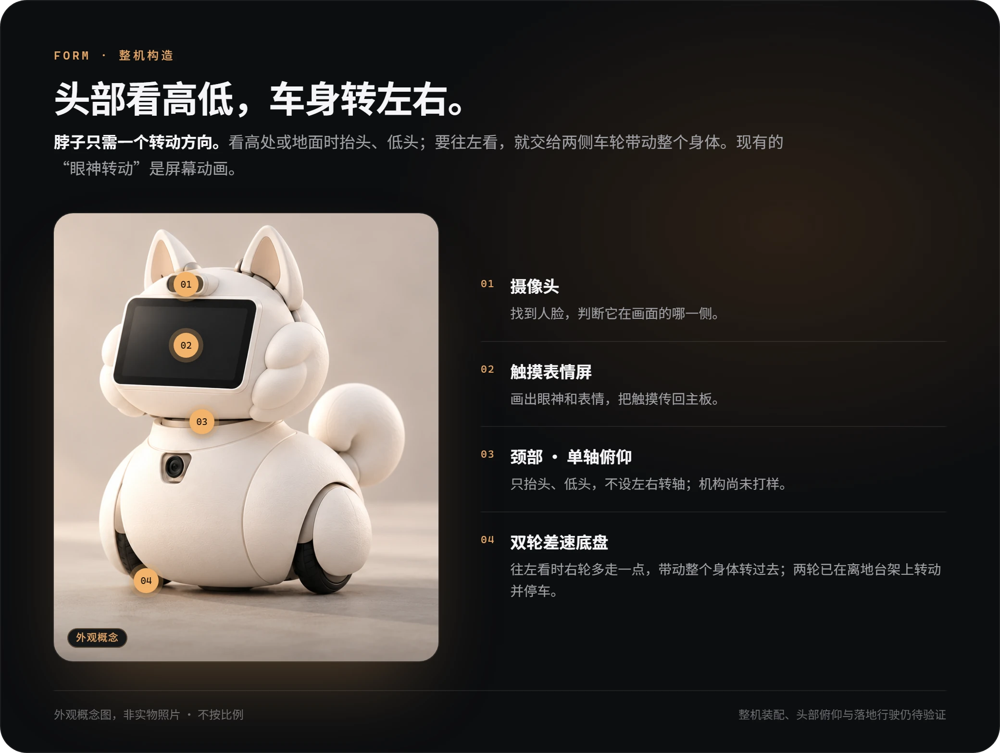
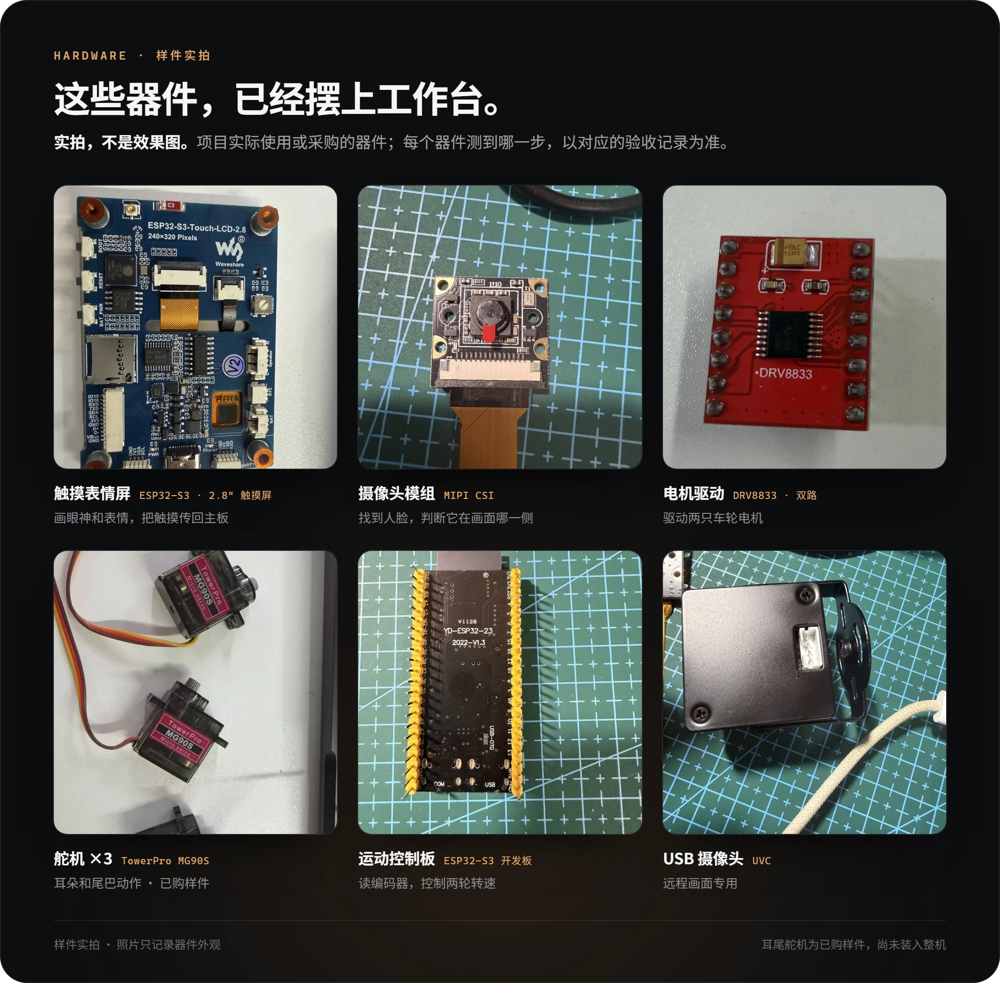
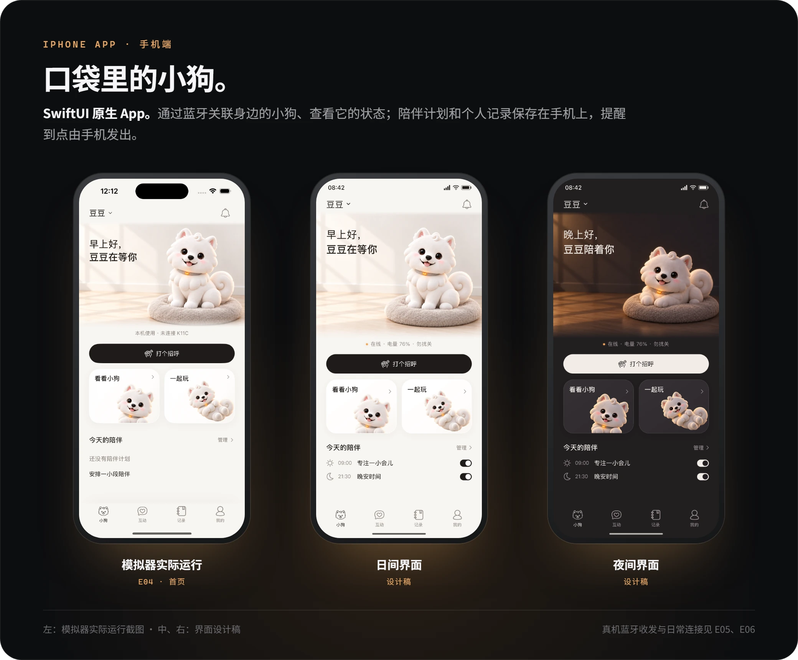
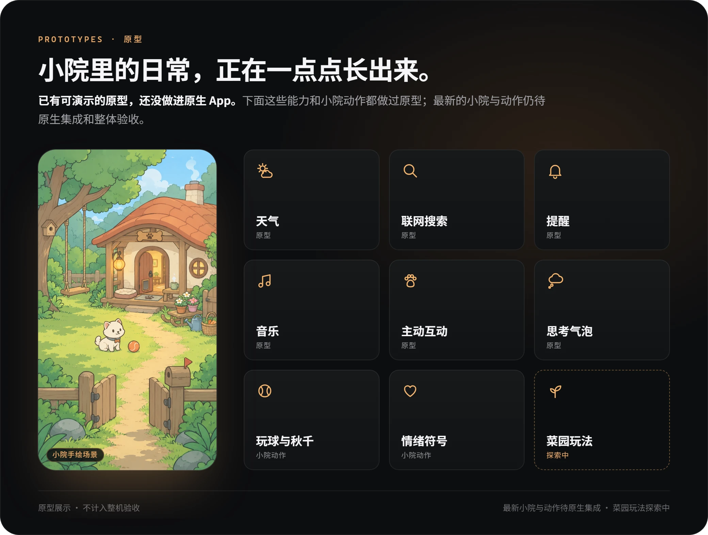

  

  <a href="docs/evidence.md"><b>实拍与验收记录</b></a>　·　<a href="docs/technology.md"><b>原理与所用模型</b></a>　·　<a href="https://companiondog-project-portfolio.syrupy-lyric-7681.chatgpt.site/"><b>交互作品集 ↗</b></a>　·　<a href="README.en.md"><b>English</b></a>
    
  <code>RK3566</code> <code>ESP32-S3 ×2</code> <code>人脸检测与识别</code> <code>本地唤醒与听写</code> <code>云端对话</code> <code>SwiftUI + 蓝牙</code> <code>WebRTC</code>

## 现在的样子

  
   表情屏单板实拍 · 原速 · 摸一下会笑，睡着时被摸醒　<a href="docs/evidence.md#看实拍表情屏怎样回应触摸">看三段完整原片 →</a>

## 进度一览

✅ 实机验证　🧪 台架或独立原型　🚧 尚未验证　·　每一项都能在[验收记录](docs/evidence.md)里按编号找到原始说明。

| | 能力 | 验证到哪一步 | 记录 |
| :---: | --- | --- | :---: |
| ✅ | 表情与触摸 | 11 类情绪动作；触摸触发、定向注视，动作结束后回到待机 | [E01](docs/evidence.md#e01) |
| ✅ | 眼神跟随 | 双板实测：左、中、右持续注视；人离开后休眠，回来后恢复 | [E10](docs/evidence.md#e10) |
| ✅ | 认出主人 | 单主人登记、识别、删除、重新登记；经同意的陌生人测试返回“未知” | [E08](docs/evidence.md#e08) |
| ✅ | 语音问答 | 7 轮完整问答；录音、等待回答、合成、播放四个阶段均可取消 | [E03](docs/evidence.md#e03) |
| ✅ | 唤醒与打断 | 叫“小狗”唤醒；短时间内可直接接话；摸屏停止播报 | [E09](docs/evidence.md#e09) |
| ✅ | 记住喜好 | 经授权整理喜好笔记，之后在相关对话中正确提起 | [E07](docs/evidence.md#e07) |
| ✅ | iPhone 连接 | 真机蓝牙收发与重连；自动连接、重开恢复、手动暂停等 6 个日常场景 | [E05](docs/evidence.md#e05) [E06](docs/evidence.md#e06) |
| 🧪 | 双轮转速控制 | 两只临时轮离地运转并停车；落地行驶、载重、制动距离未测 | [E02](docs/evidence.md#e02) |
| 🧪 | 远程看画面 | iPad 浏览器在 Wi-Fi 和热点下看到实时画面，刷新后能重连；尚未接入 App | [E11](docs/evidence.md#e11) |
| 🚧 | 整机 | 装配与供电、头部俯仰、耳尾动作、落地转向、避障防跌、长时间运行 | — |

## 它怎样回应你

和主板连在一起时，触摸还会传回主板，所以小狗说话时摸一下屏幕，它就会停下来（[E09](docs/evidence.md#e09)）。

两块板一起实测过：左、中、右持续注视，人离开后休眠，回来后恢复（[E10](docs/evidence.md#e10)）。眼神转动是屏幕动画，不需要机械头部。

跟随一张脸不需要知道对方是谁；认出主人要先登记，只用于陪伴互动，不用于安全认证（[E08](docs/evidence.md#e08)）。

实机完成 7 轮完整问答，录音、等待回答、合成和播放四个阶段都测过取消（[E03](docs/evidence.md#e03)）；唤醒、短时接话和摸屏停声见 [E09](docs/evidence.md#e09)。

体验者已确认喜好整理正确，之后也能在相关对话中自然提起（[E07](docs/evidence.md#e07)）；连续换多个话题后能否准确接回，仍在验证。

## 整机怎样构成

各器件型号与用途见[原理说明](docs/technology.md)，完整样件照片见[验收记录](docs/evidence.md#看样件实际使用或采购了哪些器件)。

## 我做了什么

这是我的个人项目，主要验收集中在 2026 年 8 月至 10 月。

- **硬件架构与选型：** 把工作拆给三块控制板（RK3566 主板 + 两块 ESP32-S3），选定摄像头、电机驱动、编码电机，以及耳尾舵机和感知器件。
- **端侧视觉与语音：** 人脸检测、主人识别和微笑判断；本地唤醒词与中文听写；主板与表情板之间的注视方向和触摸事件通信。
- **对话与记忆：** 接入云端回答和流式语音合成，做到四个阶段都能取消、摸屏即停；长期记忆按主人分开、加密保存。
- **运动控制：** 运动板读取编码器反馈，用 PI 控制让两轮跟上目标转速。
- **iPhone App：** 用 SwiftUI 和 CoreBluetooth 实现设备关联、状态查看、自动重连和提醒。
- **角色与视觉：** 萨摩耶角色和表情、App 日间与夜间界面、小院手绘场景。
- **验证与记录：** 每项能力都写清测到哪一步、还没测什么，整理成本仓库的 E01–E11 记录。

## 设计取舍

- **用眼神代替转头。** 屏幕上的眼睛可以先跟着人走，不必等机械头部做出来；头部只规划俯仰一个方向，左右交给差速底盘带动整个身体。
- **本地听，云端想。** 唤醒和听写在设备上离线完成；生成回答和合成语音交给云端，代价是需要联网，断网恢复还没有测试。
- **随时能打断。** 从录音到播放的每个阶段都能取消，说到一半摸一下屏幕就停，不用等它说完。
- **记忆先征得同意。** 只有开启记忆并同意整理后才保存喜好；记录按主人分开、加密存在设备上。人脸匹配只用于陪伴互动，不用于安全认证。
- **验收写清边界。** 每条结论都标明适用范围。比如车轮只在离地台架上转过，不能据此说整机已经能走。

## App 与视觉原型

真机蓝牙收发与重连，以及自动连接、重开恢复、手动暂停等 6 个日常场景已验证（[E05](docs/evidence.md#e05) [E06](docs/evidence.md#e06)）。

[查看小院手绘场景原图](media/courtyard.png)。最新的小院与动作仍待原生集成和整体验收，菜园玩法还在探索。

## 下一步

- **整机：** 耳尾舵机、测距和边缘感知器件已选型，头部驱动件与最终电源待定。接下来验证装配与供电、头部和耳尾动作、落地转向、避障防跌，以及整机与 App 联动和长时间运行。
- **App：** 把最新小院与动作做进原生 App，把远程画面接进 App。

---

展示集整理于 2026-11-12，依据截至 2026-10-23 已核实的项目材料。仓库只收录公开说明、造型示意与经过筛选的展示素材；不含固件源码、内部接线、私人样本或部署配置。
