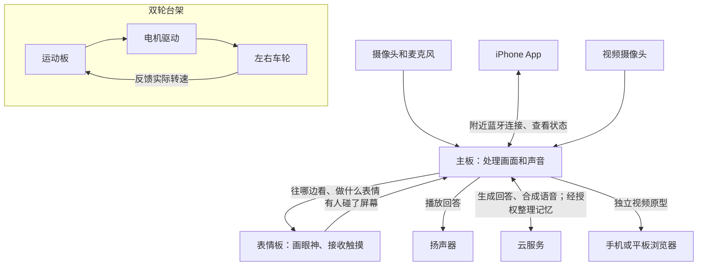

# CompanionDog · 轮式陪伴机器人

在双板实测中，人从镜头的一侧移到另一侧，小狗屏幕上的眼睛也会转向。它不必先转动脖子：摄像头找出人脸的位置，主板把方向告诉表情屏，屏幕再画出看向那一侧的眼睛。

这个轮式陪伴机器人还分别验证了认出已登记的主人、听人说话并回答、记住喜好，以及连接 iPhone。**双轮已在离地的台架上转动和停车；整机装配、头部俯仰和落地行驶仍待验证。**

[看实拍与验收记录](docs/evidence.md) · [了解功能原理与所用模型](docs/technology.md) · [打开交互作品集](https://companiondog-project-portfolio.syrupy-lyric-7681.chatgpt.site/)

| 工作台上的小狗 | 手机上的小狗 | 小狗怎样和你聊天 |
| :---: | :---: | :---: |
|  |  |  |
| 18 秒表情屏实拍预览，点图看原速视频 | App 实际运行的模拟器截图 | 验收记录 · [语音问答](docs/evidence.md#voice-dialogue) · [唤醒与打断](docs/evidence.md#voice-interaction) · [喜好回忆](docs/evidence.md#preference-recall) |

[浏览三段实拍及六张器件照片](docs/evidence.md) · [在网页播放器中观看](https://companiondog-project-portfolio.syrupy-lyric-7681.chatgpt.site/#evidence)。三段视频共 47 秒，是同一次表情屏验收录像的不同节选。

## 整机怎样构成？

**设计上，小狗怎么改变视角？** 看向高处或地面时，头部只需抬起或低下；要往左看，则由右轮比左轮多走一点，带动整个身体向左转。这样脖子只需一个转动方向。现有实拍里的“眼睛转动”是屏幕动画，头部机构尚未打样验证。[查看暖白萨摩耶外观概念图](media/hero.png)（AI 辅助渲染）。

### 三块控制板怎样分工？

主板处理看到的画面、听到的话，也负责与手机连接；表情板把回应画出来，再把触摸传回主板；运动板单独负责车轮。图中把车轮另列一组，因为这一部分目前是在台架上独立测试的。

主板是 **K11C（RK3566）**，表情板和运动板各用一块 **ESP32-S3**。[器件型号与用途详见这里](docs/technology.md)。

## 已完成哪些部分？

| 功能 | 它是怎样做到的？ | 实际验证到哪一步？ |
| --- | --- | --- |
| **认出主人** | 镜头先找到脸。登记主人时，设备记下一组面部特征；再次见面时比对这些特征。判断微笑则看嘴部形状的变化。 | 已验证单主人登记、识别、删除及重新登记，也能跟踪人脸位置、识别微笑和张嘴。主人匹配用于陪伴互动，不用于安全认证。 |
| **听你说话，也能停下来** | 叫一声“小狗”，设备在本地听出唤醒词，再把说话声转为文字；云端生成回答并合成声音，最后由扬声器播出。 | 实机完成 7 轮问答。短时接话、摸屏停声，以及录音、等回答、语音合成和播放四个阶段的取消均有验证。 |
| **在合适的时候想起喜好** | 假设你说“我喜欢爵士乐”，本轮对话可以参考刚说过的话；经你授权，这条喜好还能整理成你的个人笔记。以后聊到音乐时，小狗可以再用到它。 | 体验者已确认自己的喜好被正确整理，后来谈到相关话题时也能回忆。跨多个话题连续接话仍在验证。 |
| **用眼神和表情回应** | 主板告诉屏幕人脸在哪边，屏幕改变注视方向；反过来，手指点到屏幕，表情板也能把这次触摸告诉主板。 | 显示板有 11 类情绪动作，可眨眼、注视、响应触摸或滑动，动作结束后回到待机。首页实拍展示其中一部分。 |
| **知道轮子有没有转起来** | 运动板给出目标转速，电机上的编码器测出实际转速。两者有差别时，运动板就调整驱动，让轮子更接近目标转速。 | 两只临时轮已在悬空时运行、停车。轮子转了多少，并不能说明整机着地后走了多远，载重和制动距离还要另测。 |
| **从远处看小狗眼前的画面** | 独立的视频摄像头采集画面，主板把视频压缩后通过网络传给浏览器。 | 手机、平板浏览器已看到实拍画面，也做过短时公网测试；这个视频原型还未集成进最新 iPhone App。 |
| **用 iPhone 查看状态、安排提醒** | 附近的小狗通过蓝牙与 App 交换状态。陪伴计划和个人记录能保存在手机上，提醒到点由手机发出。 | 真机完成两轮蓝牙收发和重连，前台自动连接、重开恢复、手动暂停等 6 个场景获确认。App 也支持账号资料、昵称和偏好设置。 |

[查看对应的实机记录、样件照片与测试范围 →](docs/evidence.md)

## 原型、外观和下一步

- **已制作的原型：** 天气、联网搜索、提醒、音乐、主动互动、思考气泡；手机端已有[日间](media/app-day.png)与[夜间](media/app-night.png)界面设计、[小屋小院](media/courtyard.png)手绘场景、玩球与秋千动作及情绪符号。最新小院与动作仍待原生集成及整体验收，菜园玩法处于探索阶段。
- **整机下一步：** 耳尾舵机、测距和边缘感知器件已选型，头部驱动件与最终电源仍待确定。接下来要验证装配与供电、头部和耳尾动作、落地转向、避障防跌，以及整机与 App 联动和长时间运行。

展示集整理于 **2026-11-12**，依据截至 **2026-10-23** 已核实的项目材料。仓库只收录公开说明、造型示意与经过筛选的展示素材；不含固件源码、内部接线、私人样本或部署配置。
