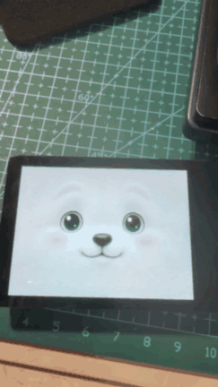
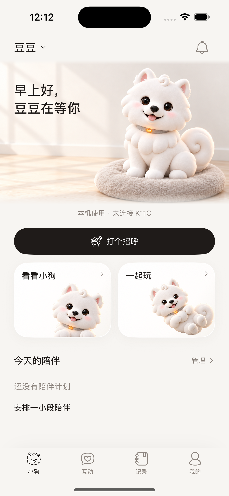
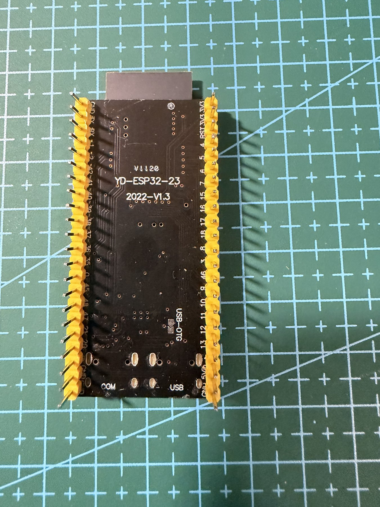
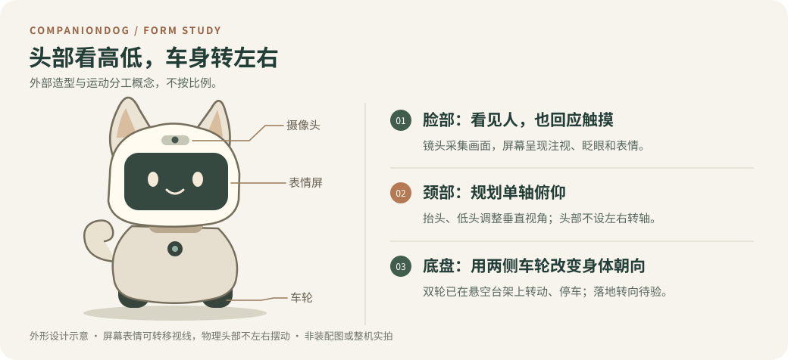
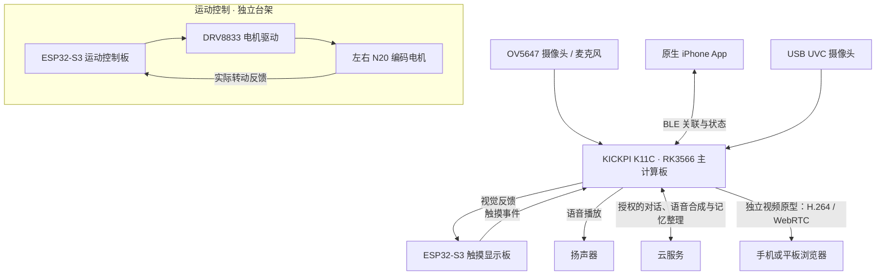

# CompanionDog · 轮式陪伴机器人

CompanionDog 用摄像头看人、用麦克风听人说话，再用屏幕上的眼神和声音回应。原型已在实物上跑通人脸识别、语音问答、个人记忆、表情触摸和 iPhone 近场连接；双轮驱动通过了悬空台架测试。**整机仍在集成，头部俯仰和落地转向尚未实测。**

[看实拍与验收记录](docs/evidence.md) · [看模型与记忆结构](docs/technology.md) · [打开交互作品集](https://companiondog-project-portfolio.syrupy-lyric-7681.chatgpt.site/)

| 工作台上的小狗 | 手机上的小狗 | 运动控制样件 |
| :---: | :---: | :---: |
|  |  |  |
| 18 秒单板实拍的降帧循环预览；点图看原速 MP4 | SwiftUI 模拟器运行截图；真机蓝牙另有验收 | 开发板背面实拍；电机运行依据台架记录 |

[浏览三段实拍及六张器件照片](docs/evidence.md) · [在网页播放器中观看](https://companiondog-project-portfolio.syrupy-lyric-7681.chatgpt.site/#evidence)。三段视频共 47 秒，是同一次表情屏验收录像的不同节选。

## 整机怎样构成？

[查看暖白萨摩耶外观概念渲染](media/hero.png)（AI 辅助设计，非实物照片）。耳朵和尾巴已为 MG90S 舵机做选型；距离与地面边缘感知分别选用 VL53L0X、TCRT5000L。头部驱动件和最终电源方案仍待确定。

### 三块控制板怎样分工？

K11C 处理图像、音频和设备连接；一块 ESP32-S3 在 **2.8 英寸 Waveshare 屏**上绘制表情并接收触摸，另一块独立控制双轮。主板与表情板已实测“视觉提示 → 屏幕回应、触摸 → 主板接收”。图中的运动分支按已验证的独立台架绘制；手机蓝牙状态连接不代表已经可以遥控底盘。

## 已完成哪些部分？

| 部分 | 采用的方法 | 已观察到的结果 |
| --- | --- | --- |
| **视觉与主人识别** | RetinaFace MobileNet 320 找到人脸，Face Mesh 478 点判断微笑、张嘴等动作，SFace 2021dec 与本地加密特征模板比对。 | 人脸位置跟踪、动作提示、单主人登记、识别、删除和重新登记通过分项验证。用于个性化互动，不作为身份认证。 |
| **语音与唤醒** | 本地 sherpa-onnx 运行 Zipformer 3M 唤醒和 Paraformer 中文 int8 识别；云端 Qwen 3.7 Flash 生成回答，腾讯“智甜”流式合成语音。 | 完成 7 轮实机问答；另已确认呼叫“小狗”、短时连续接话、触屏停声，以及录音、等待回答、合成和播放阶段的取消。 |
| **个人记忆** | RAM 保留近期对话；SQLite 按主人分开保存原话来源与结构化笔记。用户授权后，由 DeepSeek V4 Flash 整理，后续只取相关且获准使用的内容。 | 用户实际确认：保存的喜好整理正确，后来聊到相关话题时能自然提起。增强多话题承接仍在验证。 |
| **屏幕表情与双板互动** | 独立显示板绘制 11 类情绪、眨眼、注视及触摸/滑动反馈；K11C 与显示板交换高层互动事件。 | 单板动作与待机恢复完成视觉验收；两板另有视觉触发表情、左右视线跟随及触摸回传的限定实测。 |
| **双轮驱动** | 两只 N20 AB 编码减速电机经 DRV8833 驱动；运动板根据编码器反馈，用 PI 调整转速。 | 两只临时轮离地运行并停车。载重、落地轨迹、制动距离待验。 |
| **远程视频** | USB 摄像头采集，Rockchip H.264 硬编码，Pion WebRTC 传到浏览器。 | 手机、平板观看及限定公网测试通过；尚未接入下述最新原生 App。 |
| **iPhone 连接与日常功能** | SwiftUI 界面、CoreBluetooth 近场连接；管理账号资料、偏好与昵称、陪伴计划、个人记录及本地通知。 | 真机完成两轮读写、通知、断开重连；前台自动连接、状态更新、页面往返、重开恢复、手动暂停等 6 个场景获确认。计划与记录可本地恢复，提醒实际送达。 |

## 原型、外观和下一步

- **已制作的原型：** 天气、联网搜索、提醒、音乐、主动互动、思考气泡；手机端已有[日间](media/app-day.png)与[夜间](media/app-night.png)界面设计、[小屋小院](media/courtyard.png)手绘场景、玩球与秋千动作及情绪符号。最新小院与动作仍待原生集成及整体验收，菜园玩法处于探索阶段。
- **整机下一步：** 装配与电源验证、单轴俯仰头部和耳尾动作打样、负载下的落地行走与转向、距离与地面边缘感知测试，再进行整机与 App 联动和长时间运行测试。

展示集整理于 **2026-11-12**，依据截至 **2026-10-23** 已核实的项目材料。仓库只收录公开说明、造型示意与经过筛选的展示素材；不含固件源码、内部接线、私人样本或部署配置。
