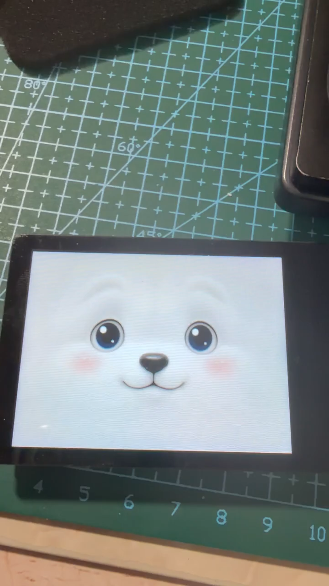
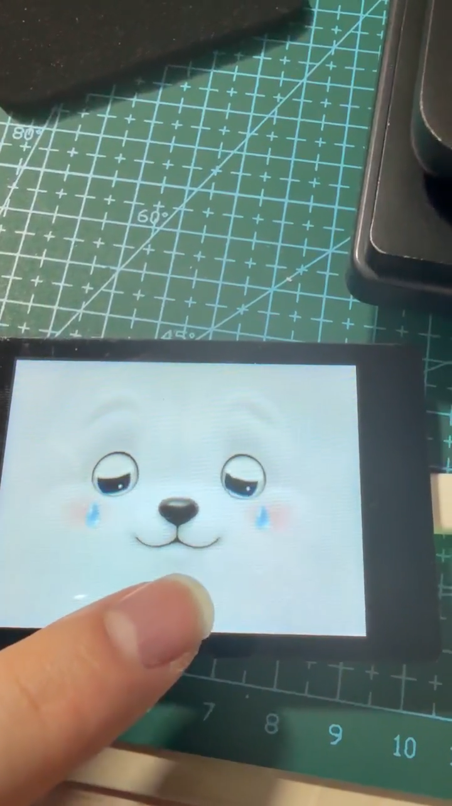
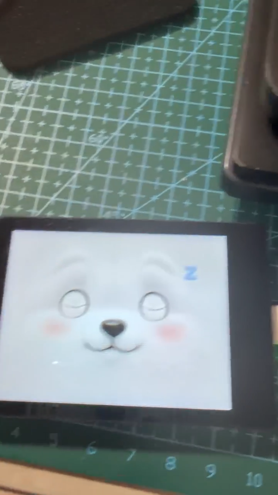
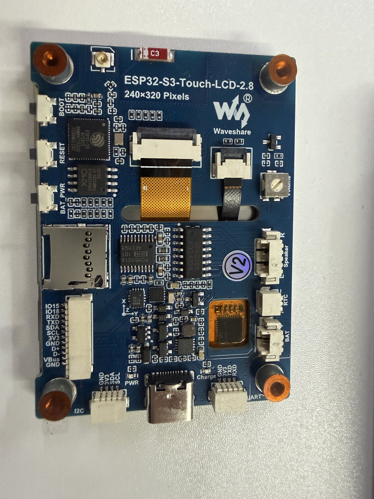
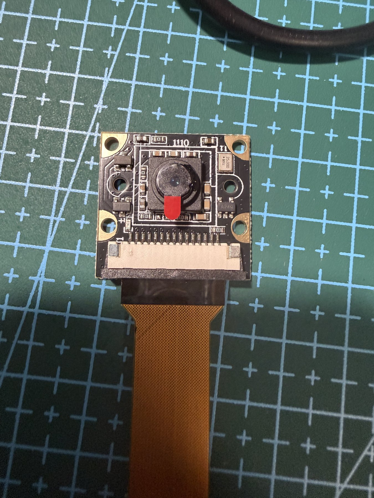
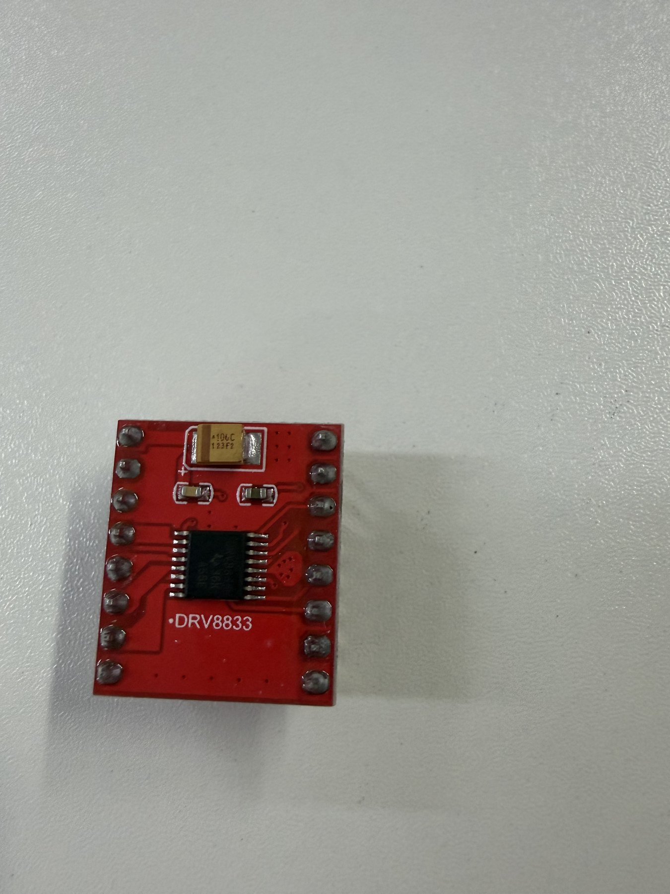
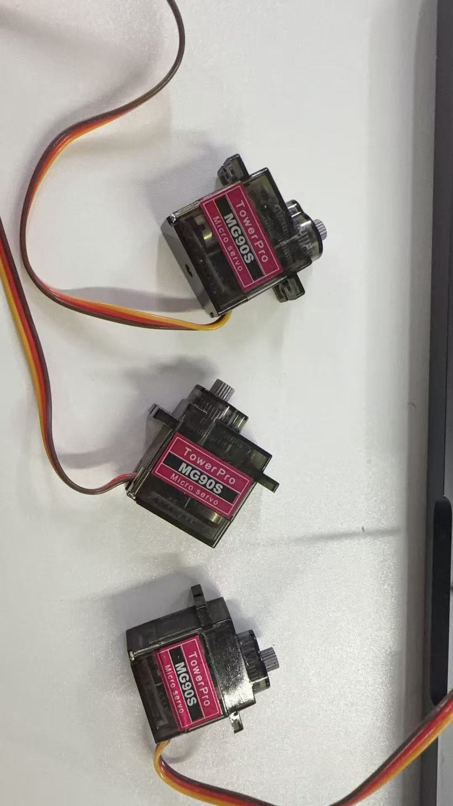
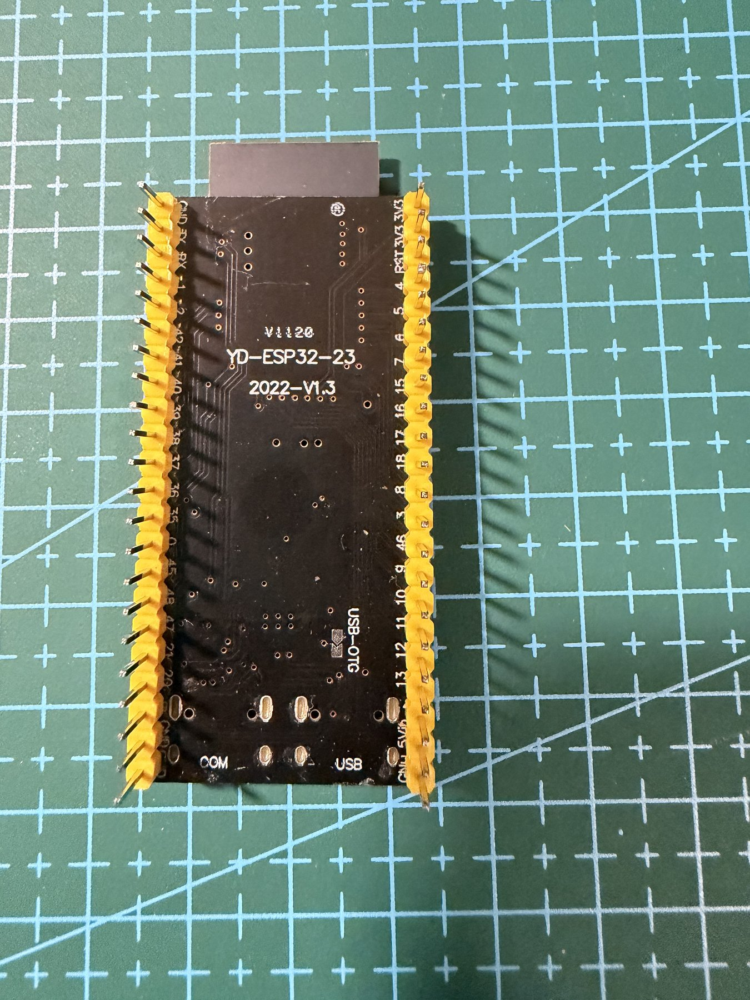
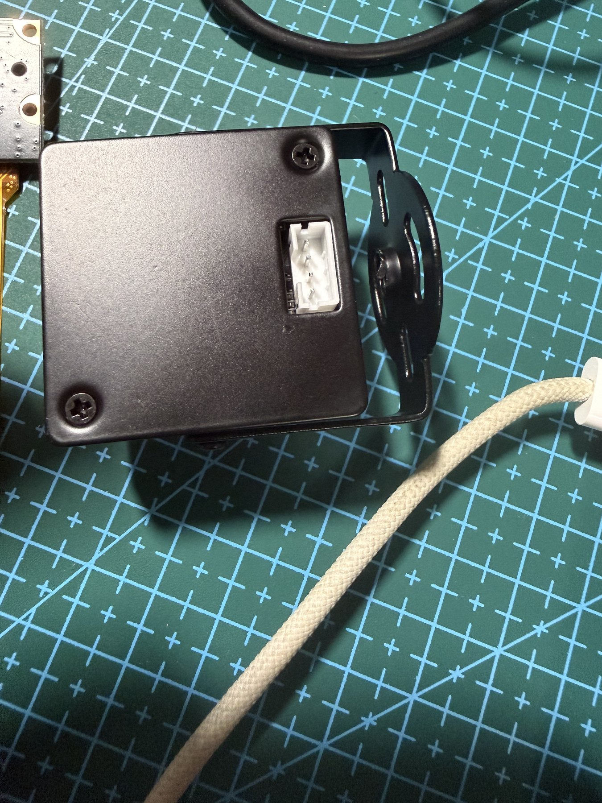

[← 返回项目首页](../README.md)

# 实机展示与验证记录

可以直接看到的是：手指触碰表情屏，小狗的眼睛、表情符号随之变化，动作结束后恢复。电机、语音、视觉、记忆和手机连接的结论另列在下方，并标明来自台架记录、设备记录还是体验者确认。

## 看实拍：表情屏怎样回应触摸

| 01 · 触摸与回应 | 02 · 表情切换与恢复 | 03 · 睡眠与再次睁眼 |
| --- | --- | --- |
|  |  |  |
| [观看 18 秒 · MP4](../media/real-display-demo.mp4) · 原片 00:00–00:18 | [观看 14 秒 · MP4](../media/real-expression-switch.mp4) · 原片 00:18–00:32 | [观看 15 秒 · MP4](../media/real-sleep-recovery.mp4) · 原片 00:44–00:59 |

三段共 47 秒，取自 **2026-08-03 同一次显示板验收关联录像**。每段保持原画面和原速度，移除了音轨与元数据。画面中的触摸网格用于单板测试；完整记录覆盖的 11 类情绪并未在这三段里全部出现。

## 看样件：实际使用或采购了哪些器件

| 触摸显示模块 | 摄像头模组 | DRV8833 电机驱动 |
| --- | --- | --- |
|  |  |  |

| MG90S 舵机 | 运动控制开发板 | USB 摄像头 |
| --- | --- | --- |
|  |  |  |

点图可查看完整照片。样件照片记录器件外观；电机是否转动、摄像头能否采集、舵机是否装进整机，需要各自的运行记录支持。耳尾舵机目前属于已购样件。

## 看记录：测试了什么，结论适用到哪里

以下为项目方根据既有研发记录整理的公开摘要。日期是对应操作或确认的日期。

| 编号 · 日期 | 操作与结果 | 验证范围 |
| --- | --- | --- |
| **E01** · 2026-08-03 | **表情屏。** 触摸触发动作、定向注视与待机恢复获现场视觉验收，完整单板记录含 11 类情绪。上方实拍可看到其中部分动作。 | 单块显示模块的短时验收；没有据此判定整机联动或长期稳定。 |
| **E02** · 2026-08-15 | **双电机。** 将两只临时测试轮固定并保持离地，观察两轮按编码器反馈运行，随后停车。台架记录与现场确认均显示两轮转动并停止。 | 一次短时悬空试验；落地行驶、载荷、制动距离仍待测。 |
| **E03** · 2026-09-16 | **语音。** 设备完成 7 轮从语音输入到回答播报的对话，并分别在录音、等待回答、语音合成和播放阶段停止；有恢复记录及现场听感确认。 | 实测数为 7 轮；未覆盖断网恢复和长时间运行。 |
| **E04** · 2026-10-16 | **App 运行。** 构建原生 SwiftUI App，安装到模拟器并启动，截取[实际运行的首页](../media/app-native.png)。 | 当时未连接设备；模拟器截图不能证明真机蓝牙连接。 |
| **E05** · 2026-10-17 | **iPhone 与设备连接。** 真实 iPhone 完成两轮蓝牙写入、通知、读取、断开和重连。设备关联、状态刷新和 App 重开后的关联恢复另有确认。 | 附近设备的收发与状态恢复；未据此判定手机已控制车轮或串接视频。 |
| **E06** · 2026-10-18 | **日常连接。** 前台自动连接、持续刷新超过 2 分钟、页面往返、后台回前台、关闭重开、手动断开后 30 秒保持断开，这 6 个场景获体验者确认，并有设备端观察。 | 手机侧结论来自人工操作反馈；不涵盖开发板断电重启或长期后台常连。 |
| **E07** · 2026-09-25 | **个人记忆。** 在开启记忆的会话中保存原话、整理个人笔记；体验者分别确认整理内容符合预期，随后在相关对话中回忆正确。 | 一次人工体验验收；未量化长期召回准确率、周期调度或多话题连续性。 |
| **E08** · 2026-08-16 | **主人识别。** 完成单人登记、识别、删除、重启及重新登记；一次经同意的陌生人测试返回“未知”。 | 用于个性化互动。未达到活体防伪要求，不用于安全身份认证。 |
| **E09** · 2026-09-25 | **唤醒与打断。** 体验者确认呼叫“小狗”可唤醒，短时间内可继续接话，触碰独立表情屏能停止播报。 | 仅确认本次基本交互；不代表已验证全天后台唤醒、所有噪声环境或全部触摸动作。 |
| **E10** · 2026-08-17 至 08-19 | **主板与表情板。** 视觉事件驱动欢迎、开心等显示动作，触摸表情板后主板收到事件；后续双板限定实测观察到左、中、右持续注视，以及人脸离开后的休眠和返回后的恢复。 | 仅覆盖测试时的板间连接与显示行为。屏幕眼神跟随不代表物理头部已会运动。 |
| **E11** · 2026-08-02 | **浏览器远程视频。** iPad Safari 在 Wi-Fi 和手机热点下均可观看真实画面，刷新后能重连；热点测试中观察到偶发短顿。 | 独立 WebRTC 原型的短时公网测试；无最新原生 App 视频集成或长时间稳定性结论。 |

## 设计预览与运行图

[11 类表情与待机画面](../media/expressions.png)是角色渲染总览；[小院场景](../media/courtyard.png)是手绘视觉原型；[App 首页](../media/app-native.png)来自模拟器实际运行。整机外观概念图与这些平台素材均不充当整机实物照片。

[返回项目首页](../README.md)
