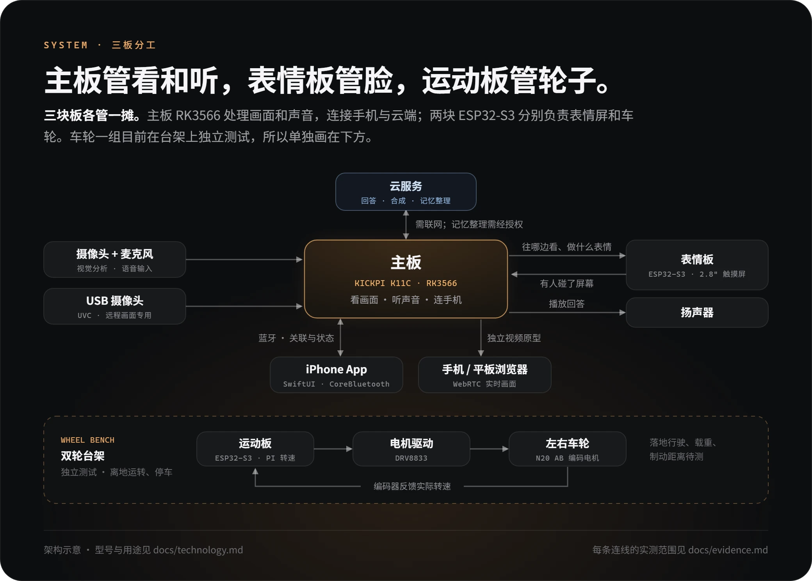
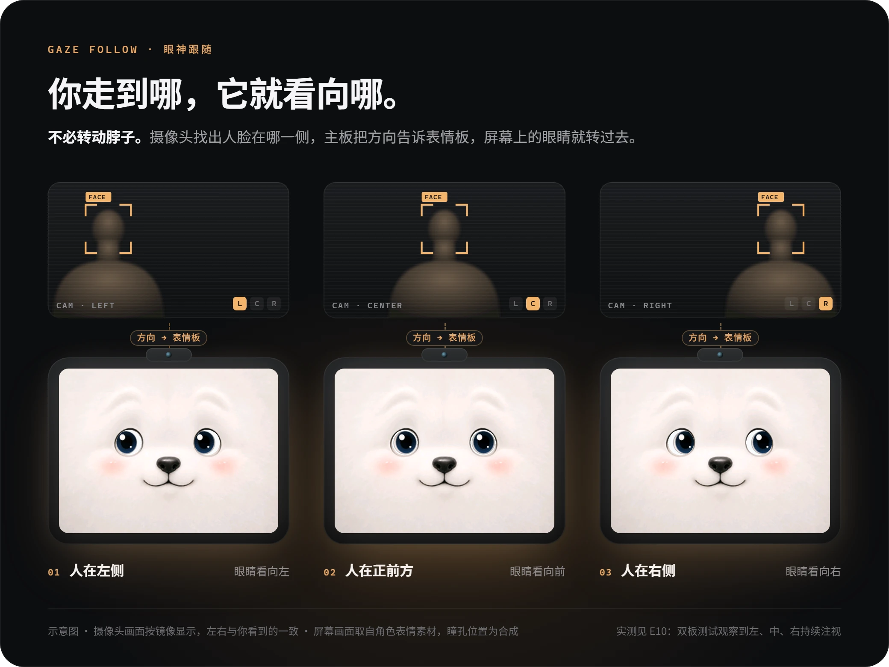
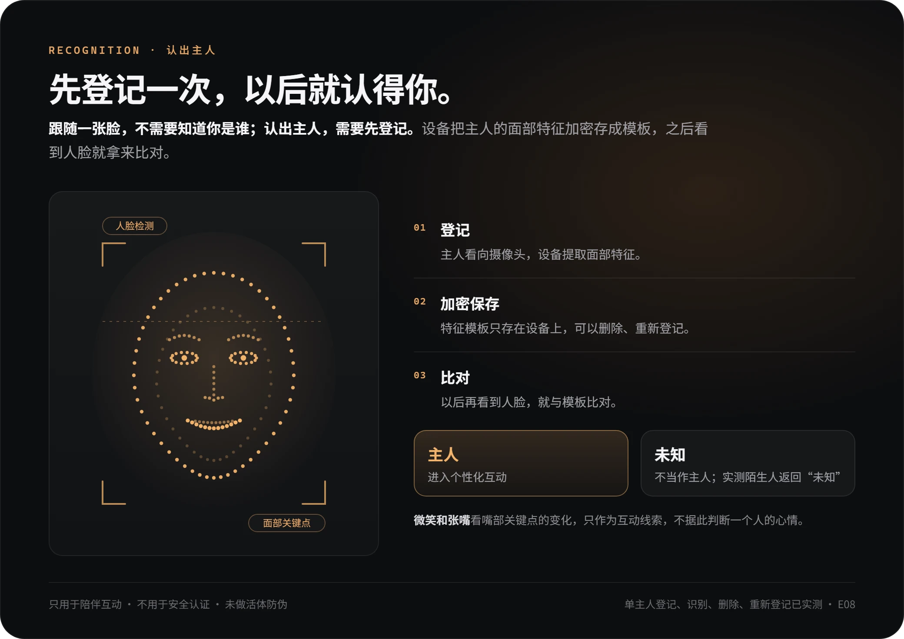
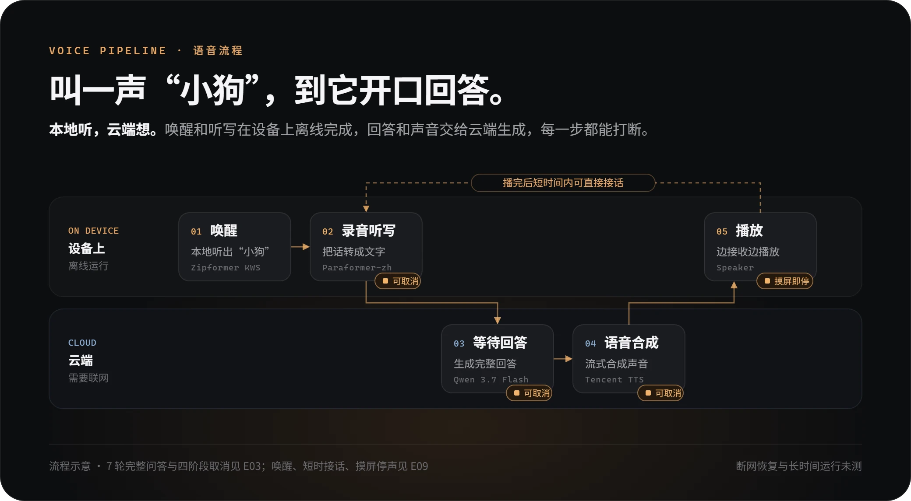
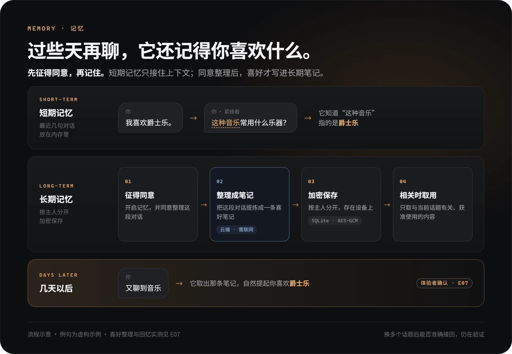
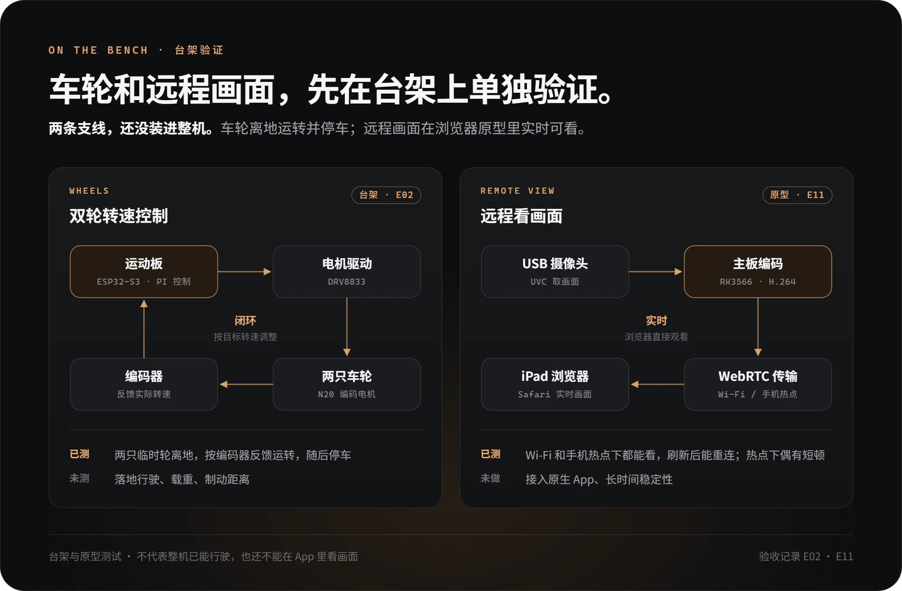

[← 返回项目首页](../README.md)　·　[实拍与验证记录](evidence.md)

# 小狗怎样看到你、听你说话，又记起你的喜好？

## 你从镜头前走过，为什么屏幕上的眼睛会跟过去？

摄像头先找到人脸，再看它落在画面的左边、中间还是右边。主板把这个方向告诉表情屏，屏幕上的眼睛便转向相应位置。两块板已一起做过这个测试（[E10](evidence.md#e10)）；整个过程不需要转动机械头部。摸一下屏幕时，信息则反过来传：显示板把触摸告诉主板，所以在语音测试中，摸屏也能让正在说话的小狗停下来（[E09](evidence.md#e09)）。

跟随一张脸不要求知道对方是谁。想认出主人，需要先由主人登记；以后再看到人脸，小狗会把提取到的特征与设备上加密保存的模板比对。微笑和张嘴则看嘴部关键点的位置变化。这些动作是看得见的线索，不能据此判断一个人的心情。单主人登记、识别、删除和重新登记已经实测（[E08](evidence.md#e08)）；这项能力用于互动，不用于安全身份认证。

## 叫一声“小狗”，声音经过了哪里？

唤醒和听写都在设备上完成：麦克风听到“小狗”后，设备再把接下来的话转成文字。回答需要网络：云端先生成回答的完整文字，再合成声音，小狗边接收音频边用扬声器播放。实机完成过 7 轮完整问答，也分别测过在录音、等待回答、合成和播放时取消（[E03](evidence.md#e03)）。

## 它为什么能接着聊，也能在以后想起一件事？

以“我喜欢爵士乐”为例（虚构示例）。如果你紧接着问“这种音乐常用什么乐器？”，**短期记忆**保留的最近几句对话，能提供“这种音乐”指什么的线索。如果过些天又聊到音乐，就需要**长期记忆**：开启记忆并同意整理后，系统按主人分别保存原话来源和整理出的个人笔记，回答时只取与当前话题有关、获准使用的内容。设备上的记录加密保存；由云端模型整理笔记的步骤需要联网。

体验者已确认喜好整理正确，后来也能在相关对话中自然提起（[E07](evidence.md#e07)）。多次换话题后仍能准确接回每个话题，是另一项尚未完成验收的能力。

## 轮子和手机连接，各能说明什么？

**轮子。** 运动板给电机一个目标转速，编码器把实际转动反馈回来，运动板据此调整驱动。两轮同速向前时，车身直行；如果两轮都向前但转速不同，在不打滑的情况下，车身就会朝较慢的一侧转弯。因此外形方案把左右观察交给车轮，头部只规划抬头和低头。两只轮子已在离地时转动并停车（[E02](evidence.md#e02)）；落地后还会遇到负载和打滑，实际转弯和停车距离需要装车再测。

**手机。** iPhone App 通过蓝牙关联身边的设备、查看它的状态。关掉 App 再打开，已关联的设备可以恢复连接；日常连接与手动暂停已用真机验证（[E05](evidence.md#e05)、[E06](evidence.md#e06)）。远程看画面走另一条路：USB 摄像头取得画面，主板压缩后经网络传到浏览器。这条独立视频原型已做过短时公网观看测试（[E11](evidence.md#e11)），尚未完整接入最新原生 App。手机遥控底盘行驶也仍待整机验证。

查看对应模型、记忆结构与硬件型号

- **视觉：** RetinaFace MobileNet 320 检测人脸，Face Mesh（478 点）提取面部关键点，OpenCV Zoo SFace 2021dec 比对主人特征。
- **语音：** sherpa-onnx 在本地运行 Zipformer 3M 唤醒、中文 Paraformer int8 听写；云端 Qwen 3.7 Flash 生成回答，腾讯“智甜”流式合成语音。
- **记忆：** 短期上下文放在 RAM；长期用 SQLite 按主人分开存储原话来源与结构化笔记。Android Keystore 管理密钥，AES-GCM 保护记录；经授权由 DeepSeek V4 Flash 整理笔记。
- **三块板：** KICKPI K11C（RK3566）负责视觉、音频与设备连接；Waveshare ESP32-S3-Touch-LCD-2.8 负责表情和触摸；独立 ESP32-S3 通过 DRV8833 驱动两只 N20 AB 编码电机，采用 PI 转速控制。
- **手机与双摄：** SwiftUI 构建 App，CoreBluetooth 管理蓝牙。OV5647 MIPI CSI 摄像头用于视觉分析；USB UVC 摄像头用于远程画面，独立原型采用 Rockchip H.264 硬件编码及 Pion WebRTC 传输。
- **待集成器件：** MG90S 用于耳尾动作选型，VL53L0X、TCRT5000L 分别用于距离与地面边缘感知选型。整机供电、头部俯仰、避障防跌和长时间运行还需验证。

设计参考：[非语言提示在人机协作中的作用（MIT）](https://www.media.mit.edu/publications/effects-of-nonverbal-communication-on-efficiency-and-robustness-in-human-robot-teamwork-2/) · [差速转向原理（ROS）](https://control.ros.org/kilted/doc/ros2_controllers/doc/mobile_robot_kinematics.html#differential-drive-robot) · [编码器信号计数（Espressif）](https://docs.espressif.com/projects/esp-idf/en/stable/esp32s3/api-reference/peripherals/pcnt.html)。这些资料解释设计选择；项目的实测结果见[验证记录](evidence.md)。
